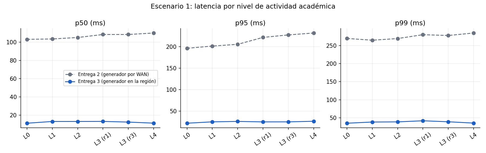
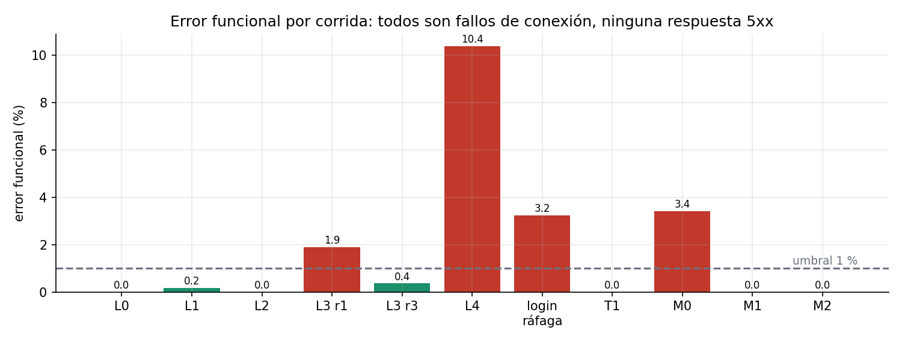
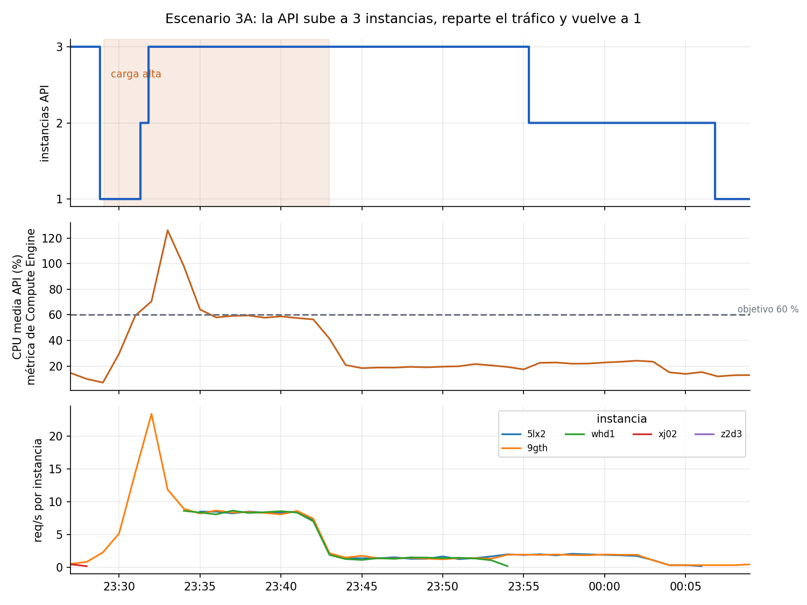
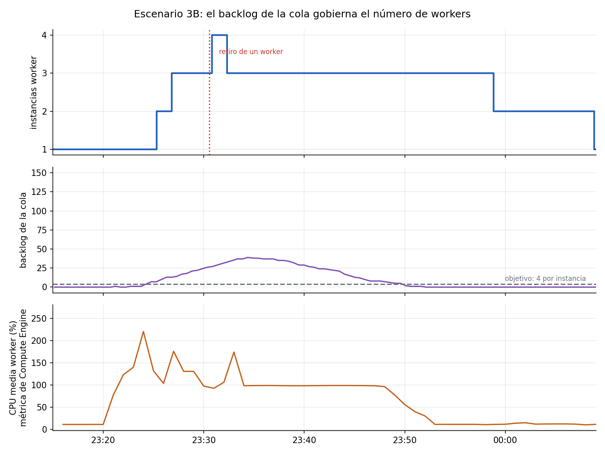
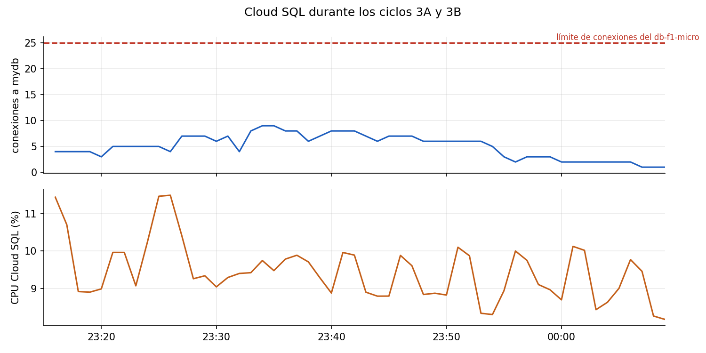

# Pruebas de carga — Entrega 3

Plataforma MOOC desplegada sobre Google Cloud con dos grupos de instancias administrados (API y workers), medida con k6 v2.3.0 desde `mooc-loadgen`, una VM `e2-highcpu-4` en la misma zona. Las cifras de este documento salen de los archivos de `capacity-planning/results/entrega3/` y de las series que Cloud Monitoring conservó durante cada ciclo; lo que es proyección va rotulado como tal y se separa de lo medido. Los números de la entrega 2 se usan como línea base de comparación, no como prueba de elasticidad.

El escenario 1 se repitió completo (cinco niveles de actividad académica con L3 dos veces, la ráfaga de login, la comprobación de integridad y la escalada abierta T1). Del escenario 2 hay tres niveles de carga directa, el consumo HLS en patrón de ráfaga y el drenaje. El escenario 3 tiene un ciclo completo de la API (3A) y uno de los workers (3B), cada uno con su aumento, su reparto de tráfico o de trabajo y su regreso al mínimo, más dos pruebas manuales de resiliencia: la caída de una API detrás del balanceador y el retiro de un worker con transcodificaciones en curso. Lo que no quedó medido se declara en la sección de límites.

## Configuración medida

El despliegue vive en el proyecto `proyecto-2-cloud-509714`, zona `us-central1-a`, y se levantó con los scripts de Terraform del repositorio. La API y los workers son `e2-small` (2 vCPU compartidas) en grupos independientes de 1 a 3 instancias; el frontend es una instancia fija; `mooc-queue` es una `e2-medium` que aloja Redis, ClamAV y las métricas de la cola, fuera de ambos grupos. La base es Cloud SQL PostgreSQL 17 `db-f1-micro`, con pools acotados (5 conexiones por API y 2 por worker) para respetar el límite de 25. Delante de la API hay un balanceador HTTPS global con certificado administrado en `https://136.68.131.0.sslip.io`. La API escala por CPU media con objetivo de 0,6, y los workers por el backlog de la cola (`pending + active`) con una asignación de 4 trabajos por instancia; ambos con 180 s de enfriamiento y, en los workers, un control que retira una instancia cada 10 minutos. Las dos señales se leen del mismo observador, que consulta el estado de los grupos, la recomendación del autoscaler y la salud del balanceador cada 30 s.

Los tiempos de arranque medidos en el despliegue, desde el encendido del kernel hasta quedar listas, fueron 59 s para la API, 123 s para el worker, 85 s para el frontend y 69 s para la cola. Con 3 API, 3 workers, frontend, cola y generador el proyecto usa los 16 vCPU de cuota, así que el máximo configurado es también el máximo alcanzable.

El generador queda dentro de la región, a diferencia de la entrega 2, donde corría en un portátil por red doméstica. Eso cambia el piso de latencia (de unos 95 ms a un dígito) y se tiene en cuenta en cada comparación. En ninguna corrida el generador se acercó a su límite: la CPU de `mooc-loadgen` no pasó del 3 % en las ventanas exportadas.

## Hipótesis y controles

La API escala por CPU promedio 0.6, entre 1 y 3 instancias. Los workers escalan por `pending + active` de la cola media, asignación de 4 trabajos por instancia, entre 1 y 3. La cola permanece en mooc-queue. Frontend fijo de 1 instancia. No cambiar estas políticas durante una comparación sin aprobación y una corrida identificada por separado.

Registrar por corrida: SHA, image_tag, hash de configuración, UTC inicio/fin, región/zona, tipo de VM, pools, concurrencia, tamaños de medios, carga ofrecida, pausas, número de usuarios, origen/red del generador, TLS y versiones de k6. Usar el mismo corpus lógico y perfiles de medios que la entrega 2; generar nuevos IDs/sesiones para el entorno actual. No reutilizar tokens históricos.

Cada repetición tiene RUN_ID único. Guardar archivos crudos, no solo capturas. Las tareas históricas `esc1:level` y `esc2:*` escriben nombres fijos: copiar sus resultados a `results/entrega3/$RUN_ID/` antes de repetir un nivel. No ejecutar `esc1:all` sin archivar la primera L3, pues la repetición sobrescribe su nombre histórico.

## Preparación

Solo después de autorizar el despliegue y verificar [operación](../docs/entrega3/operacion.md): backends sanos, certificado válido, cola vacía, métricas de ambos grupos y Cloud SQL disponibles, reloj sincronizado. Aprovisionar un administrador por el canal de operación privado. Los scripts de seed no pueden crear administradores públicos.

```bash
cd capacity-planning
export ENV=gcp INSECURE_TLS=false
export BASE_URL="$(terraform -chdir=../scripts/IaC output -raw app_url)"
# ADMIN_USER, ADMIN_PASS y SEED_PASSWORD se cargan en el entorno desde canal privado.
task media:generate
task seed:all
```

El generador debe tener capacidad suficiente. `mooc-loadgen` es opcional y no está aprovisionado: crearlo requiere autorización; si se usa el portátil, registrar ese límite y no atribuir su saturación a la aplicación. Los seeds escriben `datasets/*.json` con sesiones del entorno medido: **no se versionan** (están en `.gitignore`) y hay que regenerarlos con `task seed:all` después de cada despliegue. No publicar logs de Task que impriman contraseñas de parámetros antiguos.

## Escenarios 1 y 2: repetición comparable

Repetir actividad académica (login separado del tráfico de lectura/escritura), carga directa, TUS, consumo HLS y drenaje. Para cada nivel guardar throughput conseguido, p50/p95/p99, errores, dropped_iterations, CPU/RAM/red/disco por rol, conexiones/CPU/RAM de Cloud SQL y cola. Repetir al menos tres veces el nivel cercano al límite y reportar mediana y rango, sin seleccionar únicamente la mejor corrida.

| Escenario/nivel | Entrega 2: fuente | Entrega 3: RUN_ID | E2/E3 p95 y op/s | Errores | Cuello de botella y diferencia de condiciones |
|---|---|---|---|---|---|
| Académico L0–L4 | [Informe previo](pruebas_de_carga_entrega2.md) | `e1-L0` a `e1-L4`, `e1-L3-r3` | p95 196–232 ms y 10,8–31,5 req/s en E2; 22–26 ms y 15–28 req/s en E3 | 0 % en L0–L2; 1,9 % (L3 r1), 0,4 % (L3 r3), 10,4 % (L4), todos fallos de conexión | El generador en la región elimina el piso de red; los errores son de conexión, no de la aplicación |
| Escalada T1 (40 op/s) | Informe previo | `e1-T1` | 26 req/s con CPU de la API al 100 % en E2; 63,4 req/s con p95 de 29 ms en E3 | 0 % | La API detrás del balanceador sostiene 40 op/s abiertas con holgura |
| Ráfaga de login | Informe previo | `e1-login-burst` | p95 3 683 ms en E2; 477 ms en E3 | 3,2 % (conexión) | bcrypt dentro de la petición sigue siendo la operación más cara |
| Carga M0–M2 | Informe previo | `e2-carga-M0` a `M2` | transferencia p95 1 359–1 698 ms en E2; 190–214 ms en E3 | 3,4 % en M0 (conexión), 0 % en M1 y M2 | En E2 la transferencia medía el enlace del portátil; ahora mide el sistema |
| Consumo HLS (ráfaga) | Informe previo | `e2-consumo-burst` | segmento p95 239 ms en E2; 86 ms en E3 | 0 % | Cloud Storage no limita |
| Drenaje | Informe previo | `e2-drenaje` | 1,15 trabajos/min en un worker en E2; 3 workers, sin converger en 20 min | 5 trabajos fallidos en la cola | El procesamiento sigue siendo el cuello de botella; ahora puede escalarse |

### Actividad académica (L0–L4, T1)

Los cinco niveles con la misma mezcla de operaciones, el mismo corpus (4 profesores, 20 cursos, 500 estudiantes) y la misma pausa de uno a cinco segundos que en la entrega 2 se midieron contra la API detrás del balanceador:

| nivel | req/s | p50 | p95 | p99 | err. funcional |
|---|---|---|---|---|---|
| L0 (base) | 16,2 | 11 | 22 | 35 | 0 % |
| L1 | 14,9 | 13 | 25 | 38 | 0,2 % |
| L2 | 19,6 | 13 | 26 | 39 | 0 % |
| L3 (r1) | 24,8 | 13 | 25 | 42 | 1,9 % |
| L3 (r3) | 27,5 | 12 | 25 | 39 | 0,4 % |
| L4 | 21,4 | 11 | 26 | 35 | 10,4 % |

La latencia es plana de punta a punta, con un p95 entre 22 y 26 ms, frente a 196–232 ms en la entrega 2. Conviene no leer esa diferencia como mejora de la aplicación. El mínimo de `http_req_duration` de la entrega 2 era de 95 ms, el piso del camino por la red doméstica, y aquí ese piso desaparece porque el generador está a un salto del balanceador. Lo que sí se puede afirmar es que, sin la red de por medio, la API contesta en decenas de milisegundos incluso con 90 usuarios virtuales, y que el p95 sube apenas 4 ms entre L0 y L4.



*Figura 1. Latencia por nivel del escenario 1, entrega 2 frente a entrega 3*

El error funcional es la parte que hay que mirar con cuidado. L0 y L2 salen en cero, pero L3 supera el umbral del 1 % en una de sus dos corridas y L4 llega al 10,4 %. Clasificados por el código con el que k6 registró cada petición fallida, todos son el mismo error, `dial: i/o timeout`: el generador no logró abrir la conexión con el balanceador. No hay una sola respuesta 5xx del servidor y la validación funcional de las respuestas que sí llegaron es 1 en todas las corridas. Los fallos se reparten entre todas las operaciones (catálogo, detalle, progreso, inscripción, heartbeat), no se concentran en una, y la tasa varía entre corridas con la misma carga: L3 dio 1,9 % en la primera y 0,4 % en la segunda. Con esos tres hechos, la lectura honesta es que el error de L3 y L4 no es un límite de la aplicación demostrado, sino una limitación en el establecimiento de conexiones entre el generador y el balanceador cuya causa no se aisló. No se debe presentar L4 como el punto de saturación de la plataforma: la CPU de la API en esa ventana no se exportó y Cloud SQL, que sí se midió en los ciclos posteriores, nunca pasó de 9 conexiones de 25 ni del 12 % de CPU.



*Figura 2. Error funcional por corrida. Todos los fallos son de conexión (`dial: i/o timeout`), ninguno es una respuesta 5xx*

La escalada abierta T1, a 40 operaciones por segundo, es la que en la entrega 2 rompió el sistema: entregó 26 req/s, descartó unas 1 600 iteraciones y dejó la CPU de la API al 100 %. Ahora sostiene 63,4 req/s con p50 de 13 ms, p95 de 29 ms, p99 de 73 ms y cero errores. La diferencia combina dos factores que no se pueden separar con estas corridas: el generador ya no limita y hay hasta tres réplicas detrás del balanceador.

Una corrida de la ráfaga de login arrojó un p95 de 477 ms contra los 3 683 ms de la entrega 2. La mejora es real pero parcial: el hash bcrypt sigue ejecutándose dentro de la petición, y la corrida tuvo un 3,2 % de fallos de conexión del mismo tipo que los anteriores. La comprobación de integridad (doble envío del mismo intento, nota única, progreso) terminó sin violar ninguna invariante.

### Carga directa y consumo (escenario 2)

Los tres niveles de carga directa dejaron 87, 327 y 641 subidas aceptadas. La latencia de transferencia, que en la entrega 2 medía el techo del enlace del portátil (2,15 MB/s constantes mientras la carga se triplicaba), ahora es un dato del sistema: p95 de 214, 190 y 203 ms en M0, M1 y M2, frente a 1 359–1 698 ms antes. El tráfico de control contra la API (creación de recurso y confirmación) tiene un p95 de 346, 257 y 265 ms; en M0 hay además un máximo de 15,9 s asociado a los siete fallos de conexión de esa corrida, que es lo que lleva su error funcional al 3,4 %. M1 y M2 salen sin errores y con la validación funcional en 1.

El consumo HLS en patrón de ráfaga movió 66,9 MB en 17 753 peticiones a 55,7 req/s. La latencia de segmento es de 35 ms de mediana y 86 ms de p95, y el manifiesto se resuelve en 26 ms de mediana. En la entrega 2 el mismo patrón daba un p95 de segmento de 239 ms desde el portátil. Cloud Storage vuelve a no ser un límite: cero errores en 264 segmentos y manifiestos verificados.

El drenaje se observó 20 minutos después de las tres cargas. La cola se mantuvo entre 935 y 993 trabajos pendientes con 12 activos, que es la concurrencia de tres workers con 4 cada uno, y la antigüedad del trabajo más viejo osciló entre 344 y 1 263 s. El criterio de convergencia (pendiente y activo en cero durante tres muestras) no se cumplió y la corrida quedó registrada como no convergida, igual que en la entrega 2, aunque ahora con el triple de capacidad de procesamiento. Cinco trabajos terminaron en la cola de archivados. Frente al worker único de la entrega 2, que completaba entre 1,10 y 1,58 trabajos por minuto, aquí el grupo está en su máximo de tres instancias durante todo el drenaje, y la lectura sigue siendo la misma: el cuello de botella del escenario 2 es la transcodificación, y la diferencia es que ahora puede repartirse entre más máquinas.


## Escenario 3A: ciclo de API

[k6/esc3_api.js](k6/esc3_api.js) ofrece login real con bcrypt y comprueba identidad de la sesión en una petición posterior. Desconecta cada sesión para evitar acumulación artificial. Base 1 iteración/s, rampa 2 min, meseta 10 min (PEAK_RATE=12 por defecto), descenso 1 min y observación 20 min a demanda baja: 34 min. Ajustar únicamente la **demanda** tras un piloto si no alcanza el umbral; conservar el piloto como tal. El guard de error detiene cargas severamente fallidas; una corrida abortada no acredita el ciclo.

```bash
export RUN_ID=3a-r1
python3 observar_autoscaling.py --project proyecto-2-cloud-509714 \
  --duration 2700 --output "results/entrega3/$RUN_ID/autoscaling.jsonl"
# En otra terminal con el mismo RUN_ID y credenciales:
task esc3:api
```

Demostrar aumento automático, reparto HTTP entre réplicas sanas (`X-Served-By`), sesión persistente y regreso automático al mínimo. Que haya tres VM RUNNING no prueba que atiendan tráfico. Si no vuelve al mínimo, extender observación y explicar estabilización/cooldown; no reducir manualmente para simular un éxito.

### Resultado del ciclo de la API

Se midieron dos intentos de 3A y solo el segundo es un ciclo válido. El primero, con 12 inicios de sesión por segundo, se abrió con la API ya en tres instancias por venir de la escalada T1, así que no parte del mínimo y se conserva como piloto (`piloto-3a-r1-peak12-abortada-con-fallo-inyectado`); además, durante ese piloto se detuvo a propósito el contenedor de una API (ver más abajo) y el guion lo cortó a los 20 minutos por un 5 % de fallos de conexión. Con ese resultado se ajustó solo la demanda, a 8 por segundo, tras esperar a que el grupo volviera a una instancia. Esa es la corrida `3a-r2`: 34 minutos, 6 869 iteraciones, 20 605 peticiones, ninguna fallida, p50 de 11 ms, p95 de 99 ms y p99 de 118 ms. La latencia sube por el bcrypt de cada login y no cambia con el número de instancias.



*Figura 3. Ciclo de la API en 3A: instancias, CPU media y peticiones por segundo atendidas por cada instancia*

El ciclo se lee en tres paneles. La carga empieza a las 23:29:03; la CPU media de la API, que es la señal del autoscaler, cruza el objetivo del 60 % hacia las 23:31 y alcanza un máximo de 126 % de la métrica de Compute Engine (que puede pasar de 100 en `e2-small` por el crédito de ráfaga) cuando una sola instancia lleva todo el tráfico. El observador ve la recomendación pasar a 2 a las 23:31:19 y a 3 a las 23:31:49. La segunda instancia queda sana a las 23:32:49 y la tercera a las 23:33:49. Hacia las 23:34 las tres atienden tráfico: el panel inferior muestra a cada una con unas 8,4 peticiones por segundo, repartidas de forma casi idéntica, y con la CPU media cayendo a 57–59 %, justo sobre el objetivo. Al terminar la meseta (23:41) la CPU cae a menos de 20 %, el grupo baja a dos instancias a las 23:55:19 y a una a las 00:06:49, sin ninguna acción manual. Que haya tres máquinas encendidas no era la prueba: lo que la demuestra es que cada una sirve el mismo caudal y que las sesiones, que viven en la base y no en la instancia, siguen siendo válidas al cambiar de réplica (cero fallos del chequeo de identidad `/auth/me`).

### Caída de una API detrás del balanceador

Durante el piloto, con tres APIs sanas, se detuvo el contenedor `mooc-api` de `mooc-api-xj02` a las 23:11:45. En las 18 muestras siguientes, cada 12 s, `/health` por el balanceador respondió 200: el tráfico siguió en las otras dos. La instancia aparece como no sana en el backend a las 23:12:38, el grupo ordenó su recreación a las 23:12:21 (`compute.instances.repair.recreateInstance`), salió del backend mientras se recreaba y volvió como sana a las 23:15:39, unos cuatro minutos después de la caída. La exclusión por el balanceador y el inicio de la reparación del grupo usan el mismo chequeo de salud, así que el muestreo solo permite acotar la exclusión entre 23:11:50 y 23:12:38. La evidencia está en `docs/entrega3/evidencia/salud-lb/`.

## Escenario 3B: ciclo de workers

[k6/esc3_workers.js](k6/esc3_workers.js) reutiliza cargas directas reales. Base 1 VU, rampa 2 min, meseta 10 min (PEAK_VUS=2 y UPLOAD_PAUSE_SEC=20 por defecto), baja a cero y observa 40 min en total. La carga necesaria depende de la duración real del transcode: calibrar sin cambiar la señal de escalado. Es el backlog quien debe causar el aumento.

```bash
export RUN_ID=3b-r1
# Iniciar el mismo observador, con archivo independiente, en otra terminal.
task esc3:workers
# Después del drenaje, con ADMIN_TOKEN en el entorno:
python3 reconciliar_trabajos.py --manifest "results/entrega3/$RUN_ID/accepted.jsonl" \
  --output "results/entrega3/$RUN_ID/reconciliation.json"
```

El manifiesto correlaciona cargas aceptadas con recurso, objeto y tarea. La reconciliación comprueba que cada recurso llega a clean/ready con HLS y el mismo objeto. Esto no prueba por sí solo ausencia de ejecuciones duplicadas: contrastar logs de trabajadores, TaskIDs y salidas. Reintentos son válidos si no duplican efectos finales. Probar retirada de un worker ocupado únicamente con autorización de la operación concreta; capturar terminación, reentrega y finalización. La reducción natural a una réplica no demuestra por sí sola recuperación de una tarea interrumpida.

### Resultado del ciclo de los workers

La corrida `3b-r1` ofreció carga durante 14 minutos con 2 usuarios virtuales subiendo un archivo cada 20 s y observó hasta completar 40 minutos: 544 iteraciones, 65 cargas aceptadas, cero fallos HTTP.



*Figura 4. Ciclo de los workers en 3B: instancias, backlog de la cola y CPU media*

La carga empieza a las 23:20:49. El backlog supera el objetivo de 4 por instancia hacia las 23:24:30 y la recomendación pasa a 2 a las 23:25:19 y a 3 a las 23:26:49; las tres instancias quedan sanas a las 23:28:49. La primera instancia nueva empieza a procesar a las 23:26:24, 5 min 35 s después del inicio de la carga, que es el tiempo de efecto: reacción de la señal, creación, 123 s de arranque y primer trabajo. El backlog llega a un máximo de 39 hacia las 23:34, la carga termina a las 23:34:49 y la cola queda vacía hacia las 23:51. Con la cola en cero, el control de retiro quita una instancia cada 10 minutos: pasa a 2 a las 23:58:49 y a 1 a las 00:08:49, es decir 17 minutos después del drenaje y 34 después de que acabara la carga. Esa lentitud es deliberada (evita retirar una máquina con trabajo a medias) y es el costo de elasticidad que hay que cargar al ciclo de workers frente al de la API.

La conciliación contra la base cierra la corrida: de 65 trabajos aceptados, 63 llegaron a `available` con el mismo objeto, escaneo limpio y HLS generado, no hay identificadores de recurso duplicados, y dos (los recursos 1151 y 1153, subidos a las 23:34) quedaron como no legibles; su causa no se diagnosticó. Un `media:scan` falló a las 23:21 en `mooc-worker-n3st` con "clave inexistente" (recurso 1091): el escaneo corrió antes de que el objeto estuviera visible en el almacenamiento. Que el estado final sea correcto no prueba por sí solo que no hubo ejecuciones duplicadas; para los cuatro recursos de la prueba siguiente se contrastó cada identificador contra los logs de los workers.

### Retiro de un worker con trabajo activo

A las 23:30:33, con tres workers sanos y el backlog en su punto alto, se retiró `mooc-worker-hbnf` con `delete-instances`, y la instancia tenía cuatro transcodificaciones de ffmpeg en curso (recursos 1102, 1107, 1108 y 1109). El autoscaler repuso la capacidad con `mooc-worker-xk16` en 16 s. Las cuatro tareas se reentregaron y terminaron en `xk16`: 1108 a las 23:34:43, 1107 a las 23:34:50, 1102 a las 23:39:17 y 1109 a las 23:39:22, entre 4 y 9 minutos después del retiro. Ninguna se perdió ni quedó duplicada en la reconciliación. Esta prueba no sustituye al retiro automático del final del ciclo, que se midió aparte; se hizo durante 3B, así que ese ciclo lleva esta intervención y se interpreta con ella. La evidencia está en `docs/entrega3/evidencia/retiro-worker/`.

## Métricas y tiempos

El observador hace solo lecturas de MIG, autoscaler y salud del LB cada 30 s; conserva errores y duración de la consulta. Exportar Cloud Monitoring al terminar (esperar la latencia de ingestión):

```bash
python3 exportar_prometheus.py --project proyecto-2-cloud-509714 \
  --inicio "$START_UTC" --fin "$END_UTC" --nombre "$RUN_ID" \
  --salida "results/entrega3/$RUN_ID/monitoring"
python3 -m pip install -r requirements-entrega3.txt
python3 graficar_elasticidad.py --input "results/entrega3/$RUN_ID/autoscaling.jsonl" \
  --output "results/entrega3/$RUN_ID/elasticidad.png"
```

Incluye señal custom de cola y métricas Cloud SQL además de aplicación/host. Una serie vacía o un error de exportación debe investigarse; no equivale a consumo cero. [Referencia de métricas Cloud SQL](https://docs.cloud.google.com/sql/docs/postgres/admin-api/metrics).

Distinguir: t0 carga; t1 cruce de señal sostenido; t2 cambio de recomendación del autoscaler; t3 creación; t4 readiness/HEALTHY; t5 primer tráfico o trabajo útil; t6 reducción de carga; t7 retirada; t8 mínimo estable. Reacción=t2−t1; arranque=t4−t3; efecto=t5−t0; reducción=t8−t6. Usar guest attributes `mooc/status`, `mooc/ready-uptime-sec`, eventos de GCE y logs para precisión; muestras cada 30 s solo acotan los tiempos.

| Corrida | Señal umbral | Reacción | Arranque | 1→máximo→1 | Errores/sesiones | Trabajos aceptados/ready/fallidos | Evidencia |
|---|---|---|---|---|---|---|---|
| 3A `3a-r2` | CPU media 60 % (cruce hacia 23:31) | < 1 min (observador cada 30 s) | 1–2 min hasta sana | 1→3 en 4,8 min; 3→2 a los 14 min del fin de la carga; 2→1 a los 26 min | 0 fallos en 20 605 peticiones; sesión íntegra entre réplicas | N/A | `results/entrega3/3a-r2/`, `graficas/e3-03-ciclo-api.png` |
| 3B `3b-r1` | backlog > 4 por instancia (≈23:24:30) | < 1 min | 123 s medidos en el despliegue; primer trabajo a los 5 min 35 s | 1→3 en 8 min; 3→2 a los 24 min del fin de la carga; 2→1 a los 34 min | N/A | 65 / 63 / 2 no legibles; 0 duplicados | `results/entrega3/3b-r1/`, `graficas/e3-04-ciclo-workers.png` |

Los tiempos se leen del observador con muestras cada 30 s, así que cada hito tiene esa incertidumbre,.

### Cloud SQL y cola durante los ciclos

Cloud SQL no limitó en ningún momento: el máximo fue de 9 conexiones a la base de la aplicación sobre un límite de 25, y la CPU del `db-f1-micro` se mantuvo entre 8 y 12 %. Los pools de 5 conexiones por API y 2 por worker funcionaron como se calcularon: con tres API y tres workers el techo teórico es de 21 conexiones, y la medición quedó muy por debajo. Eso resuelve el cuello de botella de conexiones que la entrega 2 detectó antes que el de transcodificación.



*Figura 5. Conexiones y CPU de Cloud SQL durante los ciclos 3A y 3B*

## Proyección

Lo que sigue no está medido; se deduce de los datos anteriores con supuestos explícitos.

**Capacidad de la API.** En 3A, con la mezcla de login, identidad y cierre de sesión a 8 iteraciones por segundo (unas 24 peticiones por segundo), tres instancias quedaron en 57–59 % de CPU, es decir, en el objetivo de escalado. Extrapolando de forma lineal, y sabiendo que el login con bcrypt es la operación más cara, el grupo en su máximo se acercaría al 100 % de CPU hacia las 40 peticiones por segundo de esa mezcla, y una sola instancia hacia las 13. Para la mezcla académica de L0–L4, mucho más barata por petición, el valor sería mayor, pero no se midió la CPU de la API en esas corridas y no se proyecta.

**Capacidad de los workers.** En la entrega 2, un worker con 4 trabajos concurrentes completaba entre 1,10 y 1,58 transcodificaciones por minuto. Si el procesamiento escala de forma lineal con las instancias, como sugiere que el backlog del 3B se redujo con tres workers y que Cloud SQL y la cola tuvieron holgura, tres workers rondarían 3,3 a 4,7 por minuto. Con los unos 960 trabajos pendientes del drenaje, eso significa entre 3,4 y 4,9 horas de procesamiento, frente a las 10 a 14,5 horas que tomaría con un solo worker.

| Escenario | Supuesto | Estimación |
|---|---|---|
| Un worker, 960 trabajos | 1,10–1,58 trabajos/min (medido en E2) | 10,1–14,5 h |
| Tres workers, 960 trabajos | escala lineal con las instancias | 3,4–4,9 h |

Hay un límite que la proyección no cubre: el máximo del grupo es 3 por la cuota de 16 vCPU. Más allá habría que pedir cuota o usar máquinas más grandes.

## Costo del cambio

El detalle y las fuentes de precio están en [costos.md](../docs/entrega3/costos.md). Con precios de lista de `us-central1` y la configuración medida:

- mínimo (1 API + 1 worker + frontend + cola): **0,15096 USD/h ≈ 110,20 USD/mes**;
- máximo (3 API + 3 workers): **0,24001 USD/h ≈ 175,21 USD/mes**; cada instancia extra cuesta 0,0223 USD/h, unos 16,25 USD/mes;
- corrida 3A (34 min): entre 0,09 y 0,14 USD; corrida 3B (40 min): entre 0,10 y 0,16 USD;
- consumo observado del despliegue: **≈1,95 USD en 7,12 h**, calculado desde las vidas de las instancias en Cloud Audit Logs e incluyendo el generador (no hay exportación de Billing a BigQuery).

El costo de la elasticidad no está en las VM mientras hay carga, sino en el tiempo que tardan en retirarse. El control de 3B retira una instancia cada 10 minutos, así que tras el drenaje el grupo mantiene 2–3 workers durante 17–34 minutos; a 0,0223 USD/h por worker ese retraso cuesta centavos (≈0,01 USD), pero es el precio de no retirar máquinas con trabajo a medias.

## Conclusiones

Las dos mitades de la plataforma escalan por separado y por la señal que les corresponde. La API sube de 1 a 3 instancias cuando la CPU cruza el objetivo y las tres atienden el mismo caudal; los workers suben cuando el backlog supera 4 por instancia y reducen una instancia cada 10 minutos cuando la cola se vacía. Ambos grupos volvieron al mínimo sin intervención manual. Elasticidad tiene un precio medible: entre el inicio de la carga y la primera petición o trabajo atendido por una máquina nueva pasan unos 5 minutos en los dos grupos, y la vuelta al mínimo tarda entre 26 y 34 minutos, dominada por los controles de estabilización y retiro.

La disponibilidad se sostiene en lo que se probó. Con una API caída el balanceador siguió respondiendo 200 y el grupo la reemplazó en cuatro minutos. Un worker retirado con cuatro transcodificaciones activas no perdió ninguna: las tareas se reentregaron y terminaron en otra instancia. La integridad de datos (sesión entre réplicas, doble envío sin doble nota) no mostró ninguna violación.

El cuello de botella dejó de ser la base de datos y sigue siendo la transcodificación. Cloud SQL quedó por debajo de 10 conexiones y 12 % de CPU, y el drenaje no converge en 20 minutos con tres workers y un millar de trabajos, aunque ahora el grupo puede repartirlo.

Frente a la entrega 2, la mejora de latencia en el escenario 1 es en gran parte efecto del generador en la región y no debe leerse como una ganancia de la aplicación. Lo que sí cambió por la arquitectura es que T1, que antes saturaba la API, se sostiene con holgura, y que la transferencia de archivos deja de medir el enlace del portátil.

## Límites de lo medido

- **Fallos de conexión.** Los errores de L1, L3, L4, la ráfaga de login, M0 y el piloto de 3A son `dial: i/o timeout` entre el generador y el balanceador; no hay respuestas 5xx. No se aisló si vienen del generador, de la red o del balanceador, y por eso L4 no se presenta como punto de saturación. La repetición de L3 (1,9 % y 0,4 %) muestra que el efecto varía entre corridas idénticas.
- **Repeticiones.** L3 se midió dos veces; el resto de los escenarios, una vez, sin mediana ni rango. Las cifras de E2, 3A y 3B son de una sola corrida por escenario.
- **3A y 3B simultáneos.** Corrieron a la vez sobre grupos independientes. 3B sube archivos por la API, una carga pequeña adicional que afectó marginalmente la ventana de 3A.
- **Corridas sin medición.** La subida por TUS no se midió: el sondeo previo no pudo crear su recurso por el mismo tipo de fallo de conexión. El consumo HLS en patrón de reproducción no se midió porque su preparación agotó el tiempo límite. Dos corridas de preparación (L3 r2 e integridad r1) fallaron por conexión y se sustituyeron por `e1-L3-r3` y `e1-integridad-r2`.
- **Recursos no legibles.** Dos de los 65 recursos de 3B (1151 y 1153) quedaron sin poder leerse en la conciliación; su causa no se diagnosticó.
- **Intervenciones.** El ciclo de 3B incluye el retiro manual de un worker, y el piloto de 3A incluye la caída forzada de una API.
- **Alcance de las proyecciones.** Son lineales y no se validaron con una corrida; parten de que Cloud SQL y la cola siguen con holgura.

Las dos corridas descartadas por memoria del generador (el guion de L0 y L1 guardaba una copia del curso por estudiante) y la 3A que arrancó con la API en tres instancias se conservan fuera de las tablas, con sus nombres de corrida, para que la historia completa pueda auditarse.
