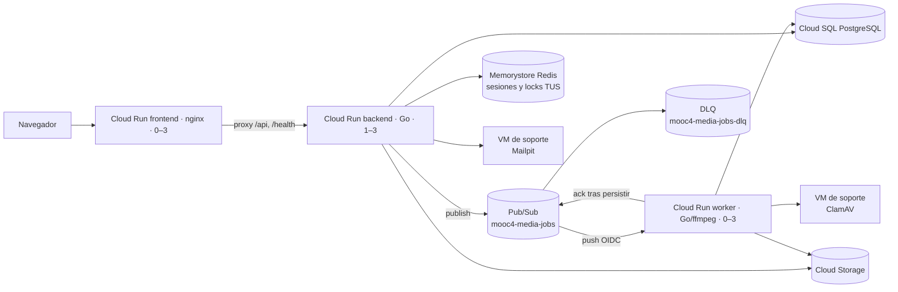
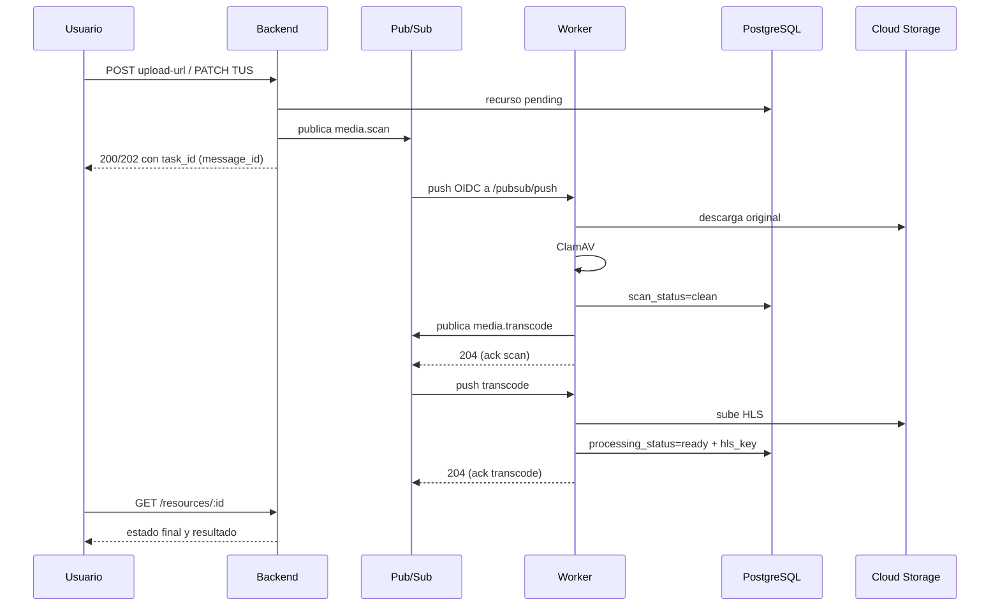

# Entrega 4 — Arquitectura Cloud Run y Pub/Sub

Estado: **redesplegado y verificado el 2026-11-15** en `proyecto-2-cloud-509714` con la imagen `b8f32af9643a`. Evidencia vigente en [RESUMEN-2026-11-15](evidencia/RESUMEN-2026-11-15.md). El despliegue del 2026-11-14 y su retiro quedan como histórico en [RESUMEN-2026-11-14](evidencia/RESUMEN-2026-11-14.md).

## Componentes

El frontend conserva rutas relativas: nginx reenvía `/api`, `/health` y `/openapi.json` al backend, así que no hace falta CORS en la API. Los buckets de Cloud Storage sí tienen CORS para las subidas firmadas y la reproducción HLS.

## Servicios Cloud Run

| Servicio | Responsabilidad | Mín. | Máx. | CPU | Memoria | Concurrencia | Timeout |
|---|---|---:|---:|---:|---:|---:|---:|
| `mooc4-frontend` | SPA React servida por nginx y proxy de la API | 0 | 3 | 1 | 512 MiB | 5 | 300 s |
| `mooc4-backend` | API REST, autenticación y publicación de tareas | 1 | 3 | 1 | 512 MiB | 10 | 300 s |
| `mooc4-worker` | Push de Pub/Sub, ClamAV y transcodificación HLS | 0 | 3 | 2 | 2 GiB | 1 | 590 s |

- Región: `us-central1`.
- Un contenedor de aplicación por instancia.
- Cloud Run puede superar temporalmente el máximo configurado según su documentación de escalamiento; la verificación se hace sobre el valor configurado (3) y las métricas observadas.

## Flujo asíncrono

- El backend responde sin esperar el procesamiento.
- El worker confirma (204) solo después de persistir el estado/resultado.
- Un error transitorio devuelve 5xx y Pub/Sub reentrega con backoff 10–600 s.
- Tras 5 intentos el mensaje pasa al dead-letter topic.
- Las reentregas son idempotentes: `scan_status=clean` no reescanea y `processing_status=ready` no vuelve a transcodificar; las claves de los objetos HLS son estables por `stable_id`.
- El worker tiene timeout de 590 s y ffmpeg de 540 s, por debajo del ack deadline máximo de 600 s.

## IAM y secretos

| Identidad | Permisos principales |
|---|---|
| `mooc4-frontend` | Artifact Registry Reader. Sin secretos. |
| `mooc4-backend` | Pub/Sub Publisher del topic; Object Admin + Legacy Bucket Reader en los 3 buckets; Secret Accessor de PostgreSQL, JWT, Redis y HMAC; Artifact Registry Reader. |
| `mooc4-worker` | Pub/Sub Publisher; Object Admin + Legacy Bucket Reader en originals/HLS; Secret Accessor de PostgreSQL y HMAC; Artifact Registry Reader. |
| `mooc4-pubsub-push` | `roles/run.invoker` solo sobre `mooc4-worker`. |
| `mooc4-job-admin` | Solo secreto de PostgreSQL y de administrador; Artifact Registry Reader. |
| Agente de Pub/Sub | Token Creator sobre la cuenta push; Publisher en DLQ; Subscriber en la suscripción. |
| `mooc4-support` | Sin roles de proyecto. |

- El worker **no** tiene binding `allUsers`; solo la cuenta push puede invocarlo.
- Secretos en Secret Manager: contraseña PostgreSQL, JWT, contraseña de Memorystore, claves HMAC por rol y contraseña inicial del administrador.
- Ningún secreto viaja en el repositorio, `terraform.tfvars` ni las imágenes.
- El estado de Terraform es local y está ignorado por git; contiene valores sensibles.

## Red y dependencias

- VPC `mooc4-vpc`, subred `10.10.1.0/24` con VPC Flow Logs al 50 % cada 10 minutos, Private Service Access `10.86.0.0/16`.
- Backend y worker usan Direct VPC Egress con etiquetas `backend` y `worker` para Cloud SQL, Memorystore y la VM de soporte.
- La VM de soporte (`mooc4-support`, `10.10.1.30`) no tiene IP pública, bloquea claves SSH de proyecto y solo acepta ClamAV desde workers y SMTP desde el backend.
- Cloud NAT permite a la VM descargar imágenes; Cloud Run usa la red de Google para APIs públicas.
- Cloud SQL exige TLS (`ENCRYPTED_ONLY`; los clientes usan `sslmode=require`) y registra conexiones y desconexiones.
- Cloud Storage tiene versionado, access logs en un bucket privado y lifecycle de versiones no actuales.
- Memorystore Redis es administrado y requiere AUTH; no hay Redis en disco local.

## Límites conocidos

- El ack deadline de Pub/Sub push es 600 s: un video cuya transcodificación exceda 540 s quedará marcado como `failed`.
- `db-f1-micro` admite 25 conexiones; los pools se presupuestan para 3 backend × 4 + 3 workers × 2 + 3 reservadas.
- Memorystore Basic no tiene alta disponibilidad; la VM de ClamAV/Mailpit es un punto único de falla.
- El frontend hace proxy de la API: el tráfico de API comparte el límite de 3 instancias del frontend.
- Las subidas normales usan URL firmada directa a Cloud Storage; TUS pasa por el timeout de 300 s del backend.

Fuentes de diagramas: [componentes.mmd](diagramas/componentes.mmd) y [despliegue.mmd](diagramas/despliegue.mmd).
