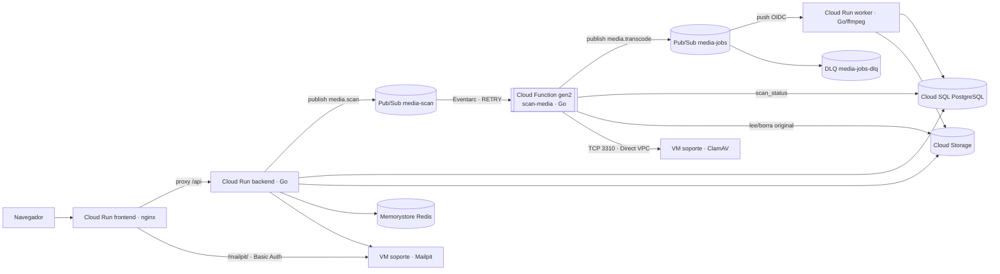

# Entrega 5 — Arquitectura con Cloud Function

Se mantiene la arquitectura de la [entrega 4](../entrega4/arquitectura.md) y se migra una tarea del worker a una **Cloud Run function de segunda generación**. Análisis completo en [analisis-serverless.md](analisis-serverless.md).

(Fuentes: [componentes.mmd](diagramas/componentes.mmd), [despliegue.mmd](diagramas/despliegue.mmd).)

## Flujo de una subida

1. El profesor sube el archivo (TUS o URL firmada) y el backend deja el recurso en `scan_status=pending`.
2. El backend publica `media.scan` en **`mooc4-media-scan`** (`queue.EnqueueScan`).
3. **Eventarc** entrega el mensaje a la función `mooc4-scan-media` (`google.cloud.pubsub.topic.v1.messagePublished`, política `RETRY`).
4. La función (`backend/functions/scanfn`, `backend/scanner`) descarga el original de Cloud Storage, lo envía a ClamAV por la VPC y escribe `scan_status` en Cloud SQL.
5. Si está limpio y es video/audio, publica `media.transcode` en `mooc4-media-jobs`.
6. El **worker** (Cloud Run) transcodifica a HLS y deja `processing_status=ready`. El worker ya no recibe, ejecuta ni publica `media.scan`.

## Cambios respecto a la entrega 4

| Área | Cambio |
|---|---|
| Código | `backend/scanner/` (lógica de escaneo y cliente ClamAV, antes en `backend/worker/`), `backend/functions/scanfn/` (función), `queue.EnqueueScan` usa `PUBSUB_SCAN_TOPIC` |
| Worker | Solo `media.transcode`; sin `CLAMAV_HOST`, sin cliente de Pub/Sub, sin permiso de publicar |
| Pub/Sub | Topic nuevo `mooc4-media-scan`; Eventarc crea su suscripción |
| IAM | Cuentas nuevas `scan-fn` (ejecución), `scan-build` (Cloud Build) y `scan-event` (disparador); secretos y claves HMAC propias |
| Red | Firewall a ClamAV (3310) pasa de la etiqueta `worker` a `scanfn` |
| Terraform | `functions.tf`, topic/permisos en `pubsub.tf`, variables `scan_fn_*`, pruebas en `tests/funcion.tftest.hcl` |

## Permisos mínimos

| Identidad | Permisos |
|---|---|
| `scan-fn` (ejecuta la función) | Secretos: contraseña de PostgreSQL y su par de claves S3. Bucket `originals`: `objectAdmin`; `legacyBucketReader` en `originals`, `hls`, `public` (el cliente comprueba que existan). Publisher en `media-jobs`. Sin rol de proyecto |
| `scan-event` (Eventarc) | `run.invoker` solo sobre la función; `eventarc.eventReceiver`; el agente de Pub/Sub puede crear tokens para esta cuenta |
| `scan-build` (Cloud Build) | `logging.logWriter`, `cloudbuild.builds.builder`, lectura del bucket de código y escritura en `mooc4-fn-artifacts` |
| `backend` | Además publica en `media-scan` |
| `worker` | Sin acceso a ClamAV ni publisher |

La función no tiene `allUsers`: `ingress = ALLOW_INTERNAL_ONLY` y solo la cuenta del disparador la invoca.
